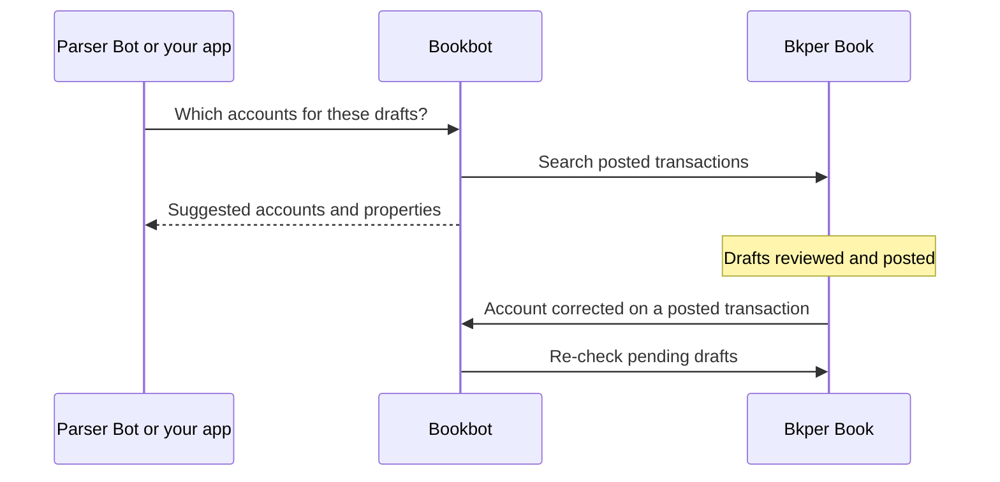

# Bookbot

Finds the right accounts for your transactions. Bookbot looks at how you recorded similar transactions before and suggests the missing From or To account, and the custom properties they always share.

[Parser Bot](https://bkper.com/apps/parser-bot) asks Bookbot for accounts every time it turns a document into draft transactions. Your own apps, scripts, and agents can ask Bookbot too, through its discovery API.

Bookbot never posts transactions and never replaces an account or property you already set.

## How it works



## Account discovery

Bookbot assigns missing From and To accounts by searching your book's posted transactions for similar patterns:

1. **Extract key terms** — AI identifies meaningful parts of the description (e.g. `Office Depot` from `OFFICE DEPOT #1234 PURCHASE 04/15`)
2. **Search by account + creator** — finds posted transactions with similar terms, scoped to the known account and user
3. **Search by account** — same search, any user
4. **Search by description** — searches across all accounts
5. **Pick by frequency** — assigns the most commonly used accounts from matching results

Accounts already on the transaction are kept. Bookbot only fills the sides that are missing.

When every matching transaction shares the same custom property (for example, a consistent `category` or `project` code), Bookbot copies that property onto the draft. It only fills missing properties and never overwrites properties already present. You can prevent selected property keys from being copied with `agent_excluded_properties`.

## Re-checking drafts after a correction

When you correct an account that Bookbot suggested on a posted transaction, Bookbot re-runs discovery on the pending drafts in the book that received the same suggestion — one correction can fix many. The re-check considers up to 100 pending drafts and is skipped when the book's backlog has more than 50 items.

## Customize description matching

Use `agent_discovery_examples` to show Bookbot which recurring parts of a transaction description are useful for finding similar posted transactions. It improves the search terms; it does not assign an account directly.

Add one example per line as `full description -> [stable part]`:

```yaml
agent_discovery_examples: |-
  WF HOME MTG DES:AUTO PAY ID:XXXXX37704 CO ID:XXXXX87461 WEB -> WF HOME MTG DES
  AMAZON RETA* NJ1JM7QA0 #goodies -> AMAZON RETA
  1* Product Alpha * 2* Product Beta -> [Product Alpha, Product Beta]
```

- On the left, use a real description from your transactions.
- On the right, keep recurring names or account identifiers; omit changing dates, amounts, quantities, and reference IDs.
- Use brackets with comma-separated values when more than one part is useful.

Set the property on an **account** for account-specific formats, an **account group** for shared formats, or the **book** as a general fallback. Bookbot uses the first non-empty value in account → first matching group → book order; values are not combined. When no account is known yet, only the book value applies. Custom examples replace the built-in examples.

## Discovery API

Apps, scripts, and agents can ask Bookbot for accounts without creating anything in the book:

- `POST /api/v1/discovery` — one transaction
- `POST /api/v1/discovery/batch` — several transactions, processed in order

Each item names the target book and a draft transaction, and can include the source account to enable property copying. Bookbot returns the transaction with its suggestions and an outcome: `changed`, `no_change`, `no_match`, or `error`. The API reads your book but never writes to it; recording the drafts is up to the caller.

Calls are made as a signed-in Bkper user with read access to every target book; no installation is required. For example, with the Bkper CLI:

```bash
bkper app api request bookbot /api/v1/discovery -d '{
  "itemId": "1",
  "bookId": "<bookId>",
  "transaction": { "description": "Monthly rent", "creditAccount": { "id": "<accountId>" } }
}'
```

The full contract is published at [bookbot.bkper.app/openapi.json](https://bookbot.bkper.app/openapi.json).

## AI allowance behavior

Discovery uses Bkper AI to pick out the key terms of a description, with Gemini Flash Lite and minimal reasoning. Inference runs with the allowance of the signed-in user, or of the installation principal for event-driven re-checks, and is attributed to Bookbot. For Business and Professional subscriptions, the Bkper AI allowance may be shared across the domain. The Bkper AI usage dashboard shows the usage attributed to Bookbot.

## Configuration

<details>
<summary><strong>Account, group, and book properties</strong></summary>

| Property | Description |
|---|---|
| `agent_discovery_examples` | Examples showing which stable parts of transaction descriptions Bookbot should use to search for similar posted transactions. See [Customize description matching](#customize-description-matching). |
| `agent_excluded_properties` | Comma- or whitespace-separated property keys that Bookbot never copies from historical transactions, for example `"trade_date, settlement_date"`. The effective value is resolved from the account, then the first matching account group, then the book; the first non-empty value wins. Matching is case-insensitive and exact. |

</details>

<details>
<summary><strong>Events handled</strong></summary>

| Event | Behavior |
|---|---|
| `TRANSACTION_POSTED` | If an account that Bookbot suggested was corrected, re-runs discovery on pending drafts that received the same suggestion |
| `TRANSACTION_UPDATED` | Same as `TRANSACTION_POSTED` |

</details>

<details>
<summary><strong>Transaction metadata</strong></summary>

Bookbot's suggestions are recorded on drafts as internal properties (suffixed with `_`) used for traceability and re-checks:

| Property | Description |
|---|---|
| `agent_credit_account_id_` | ID of the suggested credit account |
| `agent_debit_account_id_` | ID of the suggested debit account |
| `agent_description_part_` | The key term that matched during discovery |
| `agent_discovered_properties_` | Keys of the properties copied from history |

</details>

## Learn more

- [Parser Bot](https://bkper.com/apps/parser-bot) — reads documents and creates draft transactions
- [Recording transactions](https://bkper.com/docs/guides/using-bkper/record-guide) — how to record and manage transactions in Bkper
