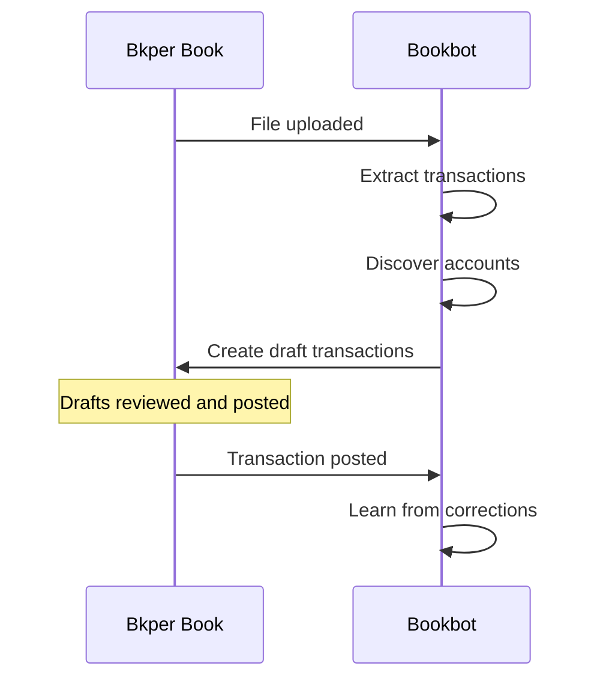

# Bookbot

Automatically extracts transactions from uploaded documents using AI. Drag invoices, receipts, or bank statements into your book — Bookbot extracts dates, amounts, and descriptions, then finds the right accounts based on your transaction history.

Bookbot learns from your corrections and improves extraction accuracy over time.

## How it works



**Upload** — select an account and drop a file into the book. Bookbot extracts transactions from the document and creates drafts. For bank statements and CSVs, it creates one transaction per line item. For invoices and receipts, it creates a single transaction.

**Attach** — drop a file onto an existing transaction. Bookbot extracts data and updates the transaction with the extracted amount, date, description, and custom properties.
> *Note: Attachments are always treated as invoices or receipts, even if the file is a multi-page statement.*

Bookbot detects the document type automatically:
- **CSV files** are always treated as statements (one transaction per row).
- **PDFs and images** are analyzed to decide if they contain a statement table (multiple transactions) or an invoice/receipt (single transaction).

## Account discovery

After extracting data, Bookbot assigns From and To accounts by searching your book's transaction history for similar patterns:

1. **Extract key terms** — AI identifies meaningful parts of the description (e.g. `Office Depot` from `OFFICE DEPOT #1234 PURCHASE 04/15`)
2. **Search by account + creator** — finds posted transactions with similar terms, scoped to the selected account and user
3. **Search by account** — same search, any user
4. **Search by description** — searches across all accounts
5. **Pick by frequency** — assigns the most commonly used accounts from matching results

When you correct an account and post the transaction, Bookbot re-runs discovery on all pending drafts in the book — one correction can fix many.

### Customize description matching

Use `agent_discovery_examples` to show Bookbot which recurring parts of a transaction description are useful for finding similar posted transactions. It improves the search terms; it does not assign an account directly.

Add one example per line as `full description -> [stable part]`:

```yaml
agent_discovery_examples: |-
  WF HOME MTG DES:AUTO PAY ID:XXXXX37704 CO ID:XXXXX87461 WEB -> WF HOME MTG DES
  AMAZON RETA* NJ1JM7QA0 #goodies -> AMAZON RETA
  1* Product Alpha * 2* Product Beta -> [Product Alpha, Product Beta]
```

- On the left, use a real description from your transactions.
- On the right, keep recurring names or account identifiers; omit changing dates, amounts, quantities, and reference IDs.
- Use brackets with comma-separated values when more than one part is useful.

Set the property on an **account** for account-specific formats, an **account group** for shared formats, or the **book** as a general fallback. Bookbot uses the first non-empty value in account → first matching group → book order; values are not combined. When no account is known yet, only the book value applies. Custom examples replace the built-in examples.

When Bookbot finds matching transactions to determine the accounts, it also looks at the **custom properties** on those historical transactions. If every matching transaction shares the same property (for example, a consistent `category` or `project` code), Bookbot copies that property onto the new draft. It only fills missing properties and never overwrites properties already present on the draft. You can prevent selected property keys from being copied with `agent_excluded_properties`; this setting is read-only and is never populated automatically.

Bookbot also extracts amounts and dates from transaction descriptions using AI, even without a file upload.

## AI allowance behavior

All built-in AI inference runs through Bkper AI using the allowance associated with Bookbot's installation principal. Document extraction and learning use Gemini Flash with medium reasoning, lightweight classification and field utilities use Gemini Flash Lite with minimal reasoning, and semantic comparisons use the decision model. For Business and Professional subscriptions, the Bkper AI allowance may be shared across the domain.

When the allowance is exhausted:

- document extraction fails without creating partial draft transactions;
- Bookbot does not bypass the limit through another model provider;
- invoice learning is skipped;
- pending statement learning remains flagged for a later run.

The Bkper AI usage dashboard shows the current allowance and usage attributed to Bookbot.

## Learning from corrections

When you edit an AI-extracted transaction and post it, Bookbot compares the posted version against its original extraction. If the data changed significantly, it improves its extraction instructions:

1. **Reflect** — analyze what the extraction got wrong
2. **Curate** — generate new instructions and merge with existing ones
3. **Validate** — re-extract the document with the improved instructions and verify results are better without regressions

The improved instructions are saved to purpose-specific properties on the account or group: `agent_parser_transaction` for invoices and receipts, and `agent_parser_transactions` for statements. Future documents processed through that account or group benefit from the accumulated learning.

For invoices, this runs immediately on post. For statements, Bookbot flags the account or group and processes improvements asynchronously.

When an account or group has **no stored prompt yet**, the first posted transaction through that account can establish a baseline prompt automatically — even if you made no corrections. This gives Bookbot a starting point for future improvements.

Legacy extraction instruction properties (`agent_prompt`, `agent_prompt_transaction`, `agent_prompt_transactions`, and `agent_prompt_file`) are migrated automatically when Bookbot next uses the account or group. Their values are copied to the corresponding `agent_parser_*` properties and the legacy properties are removed.

## Configuration

<details>
<summary><strong>Account and group properties</strong></summary>

| Property | Description |
|---|---|
| `agent_parser_transaction` | Custom extraction instructions for invoices and receipts that produce a single transaction |
| `agent_parser_transactions` | Custom extraction instructions for statements and CSVs that produce multiple transactions. Bookbot appends learned statement instructions here automatically |
| `agent_parser_file` | Custom extraction instructions for file-level metadata properties, such as invoice numbers, statement periods, or bank names |
| `agent_excluded_properties` | Comma- or whitespace-separated property keys to exclude from property discovery and ACE extraction comparison/learning. The effective value is resolved from the account, then the first matching account group, then the book; the first non-empty value wins. Matching is case-insensitive and exact. |
| `agent_discovery_examples` | Examples showing which stable parts of transaction descriptions Bookbot should use to search for similar posted transactions. See [Customize description matching](#customize-description-matching). |
| `agent_parser_url_transaction` | URL of an external invoice/receipt extraction service that returns one transaction |
| `agent_parser_url_transactions` | URL of an external statement extraction service. When set, multi-transaction file parsing is delegated to this endpoint instead of using built-in AI |
| `agent_parser_url_file` | URL of an external file metadata extraction service that returns file properties |

**Example — custom statement extraction instructions:**

```yaml
agent_parser_transactions: |-
  Extract transactions from the statement table.
  - Do not include header rows
  - Include the reference number as a property called "ref"
```

**Example — skip properties that vary per transaction:**

`agent_excluded_properties` uses plain delimiter-separated text, not a JSON array:

```yaml
agent_excluded_properties: "trade_date, settlement_date"
```

The property can be set on the selected account, one of its groups, or the book. The lookup order is:

1. the selected account;
2. the first account group with a non-empty value;
3. the book.

The first non-empty value wins; values are not merged. Keys are matched case-insensitively and exactly, so `category` does not block `category_code`.

For property discovery, listed keys are not copied from historical transactions. Existing draft properties are not deleted or overwritten, and discovery does not modify `agent_excluded_properties`. For ACE, listed keys are excluded from extraction comparison and learning. An explicit group attached to a file is not used for property discovery.

</details>

<details>
<summary><strong>Book properties</strong></summary>

| Property | Description |
|---|---|
| `agent_parser_url_transaction` | URL of an external invoice/receipt extraction service for this book. Account and group `agent_parser_url_transaction` take priority |
| `agent_parser_url_transactions` | URL of an external statement extraction service for all statement files in this book. Account and group `agent_parser_url_transactions` take priority |
| `agent_parser_url_file` | URL of an external file metadata extraction service for this book. Account and group `agent_parser_url_file` take priority |
| `agent_excluded_properties` | Book-level fallback list of comma- or whitespace-separated property keys to exclude. It is used only when no non-empty account or account-group value is configured. |
| `agent_discovery_examples` | Book-level fallback examples for stable description-part extraction. Used when the known account and its groups have no non-empty value, or when no account is known before discovery. |

</details>

<details>
<summary><strong>Events handled</strong></summary>

| Event | Behavior |
|---|---|
| `FILE_CREATED` | Extracts transactions from the uploaded file and creates draft transactions. Delegates purpose-specific extraction to external services when parser URL properties are set |
| `TRANSACTION_CREATED` | When a transaction has an attached file, extracts transaction and optional file metadata, then updates it. Also runs account discovery and AI-based amount/date extraction on all new transactions |
| `TRANSACTION_POSTED` | Compares posted data against the original AI extraction and improves the prompt if corrections were made. If the posted transaction's credit or debit account changed, Bookbot re-runs account discovery on pending drafts in the book (skipped when the backlog has more than 50 items) |
| `TRANSACTION_UPDATED` | Same as `TRANSACTION_POSTED` |
| `TRANSACTION_DELETED` | Flags the source account for prompt improvement when a statement-extracted transaction is deleted, indicating a false positive |
| `BOOK_AUDITED` | Processes one flagged account or group, running the full improvement pipeline for statement extraction |

</details>

<details>
<summary><strong>Supported file types</strong></summary>

| Format | Extensions |
|---|---|
| CSV | `.csv` |
| PDF | `.pdf` |
| Images | `.jpg`, `.jpeg`, `.png`, `.bmp`, `.webp` |

</details>

<details>
<summary><strong>External extraction service</strong></summary>

External parsers are configured per purpose. A parser URL takes precedence over the GenAI prompt for that same purpose:

- `agent_parser_url_transaction` returns `data.transaction` for invoices and receipts.
- `agent_parser_url_transactions` returns `data.transactions` for statements and CSVs.
- `agent_parser_url_file` returns `file.properties` for file-level metadata.

Lookup priority is account property, account's group property (first match), explicit group property, then book property. The service receives a POST request with file content (base64-encoded), book metadata, and account context when available. When the parser URL is configured on a group property, the request also includes that matched group context.

For statement transactions, each returned transaction can optionally include:
- `book_id` — record the transaction in a different book than the upload target
- `account_name` — assign the transaction to a specific account by name

The same endpoint may be configured for multiple parser URL properties; Bookbot consumes only the response section for the configured purpose.

</details>

<details>
<summary><strong>Transaction metadata</strong></summary>

Bookbot stores metadata on processed transactions. These are internal properties (suffixed with `_`) used for learning and traceability:

| Property | Description |
|---|---|
| `agent_extracted_` | Original AI extraction data (JSON). Used to detect corrections when the transaction is posted |
| `agent_file_id_` | ID of the source file. Links statement transactions to their document |
| `agent_credit_account_id_` | ID of the discovered credit account |
| `agent_debit_account_id_` | ID of the discovered debit account |
| `agent_description_part_` | The key term that matched during account discovery |

After creating drafts, Bookbot stores a `transactions_summary` file property for multi-transaction extractions and non-zero single-transaction extractions. Each target book/account entry contains the expected non-zero transaction count and the native Bkper transaction IDs returned by transaction creation. A single-transaction extraction has one summary entry. Zero-amount drafts are still created but excluded from the summary, so a file containing only zero-amount transactions does not receive one. If a fetched file already has `transactions_summary`, Bookbot skips parsing it again. The order of IDs in an entry is not significant.

`transactions_summary` is owned by Bookbot and cannot be supplied or overridden by an external file-properties parser.

</details>

## Learn more

- [Recording transactions](https://bkper.com/docs/guides/using-bkper/record-guide) — how to record and manage transactions in Bkper
