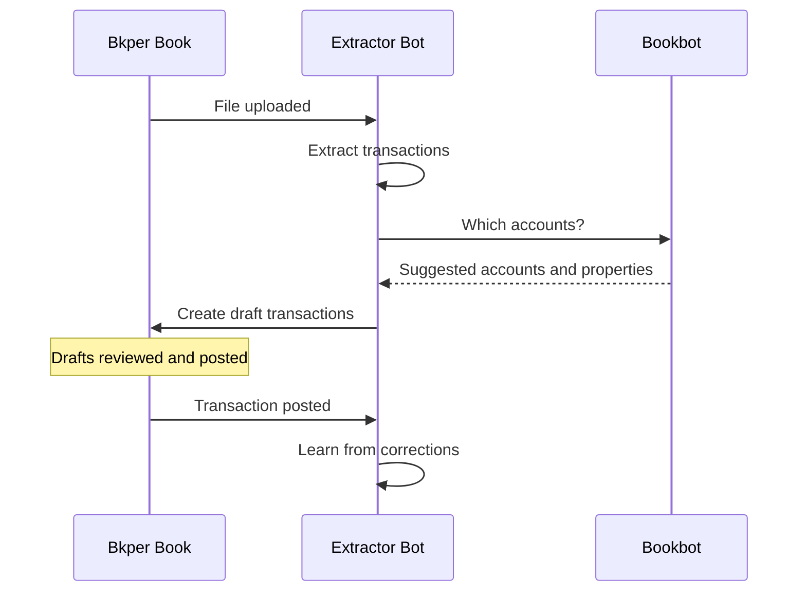

# Extractor Bot

Reads your documents and turns them into draft transactions. Drag invoices, receipts, or bank statements into your book — Extractor Bot extracts dates, amounts, and descriptions with AI, asks [Bookbot](https://bkper.com/apps/bookbot) for the right accounts, and records unposted drafts for you to review.

Extractor Bot learns from your corrections and improves its extraction over time. It never posts transactions: you review and post every draft.

## How it works



**Upload** — select the account the document belongs to, such as the bank account of a statement, and drop the file into the book. The account sets which learned instructions apply and which side of the drafts it takes. Agents and scripts upload with `bkper file upload <path> -b <bookId> --account "<account>"`. For bank statements and CSVs, Extractor Bot creates one draft per line item. For invoices and receipts, it creates one draft with the file attached.

**Attach** — drop a file onto an existing transaction. Extractor Bot fills in the missing amount, date, and description, adds extracted custom properties, and updates the transaction. Attached files are always read as one invoice or receipt, even multi-page statements.

**Type** — create a transaction without an attachment. Extractor Bot fills a missing amount from the description, and a date written in the description replaces the date Bkper filled in automatically.

CSV files are always read as statements. PDFs and images are analyzed to decide whether they hold a statement table or a single invoice or receipt.

Each uploaded file is read once. After recording its drafts, Extractor Bot stores an `extractor_transactions_summary` property on the file and skips files that already have one (or the earlier `transactions_summary`). When extraction fails, no drafts are created, and the error appears in the book activity as Extractor Bot's response to the event. When a statement sends rows to several books, each book is recorded in turn: if one fails, drafts already created in the other books remain and the file gets no summary, so check those books before replaying the event.

## Accounts come from Bookbot

Extractor Bot extracts; [Bookbot](https://bkper.com/apps/bookbot) finds accounts. Before recording drafts, Extractor Bot asks Bookbot for the missing From or To account, based on your posted transactions. When those transactions used different accounts, Bookbot ranks them by comparing amount, date, and properties, and suggests one only when it is confident. When the past transactions of the suggested account share a custom property, such as `category` or `project`, Bookbot copies it onto the draft. Accounts you selected and properties already on the draft are never replaced.

If Bookbot cannot be reached, Extractor Bot still records the drafts, without suggested accounts, and its response in the book activity includes a warning.

## Learning from corrections

When you correct an extracted draft and post it, Extractor Bot compares it with the original extraction. If the data changed significantly, it writes improved extraction instructions and keeps them only when re-extracting the document gives better results without regressions.

Instructions are saved on the account or group the document came through: `extractor_prompt_transaction` for invoices and receipts, `extractor_prompt_transactions` for statements. They are plain text that you can read and edit.

- **Invoices and receipts** are learned from right after posting.
- **Statements** flag their account or group; each book audit (`BOOK_AUDITED`) improves one flagged account or group. Deleting a draft extracted from a statement also flags it, because that row should not have been extracted.
- **No instructions yet**: the first posted transaction through an account or group can set baseline instructions, even without corrections.
- **Account corrections** teach Bookbot, not Extractor Bot. When Bookbot is installed, it re-checks other pending drafts that received the same account.
- **Older books**: instructions in the earlier `agent_parser_*` properties, and in the legacy `agent_prompt`, `agent_prompt_transaction`, `agent_prompt_transactions`, and `agent_prompt_file` properties, move to the matching `extractor_prompt_*` properties the next time Extractor Bot uses the account or group.

## AI allowance behavior

Extractor Bot uses Bkper AI: Gemini Flash for extraction and learning, Gemini Flash Lite for small tasks such as classification, and the decision model for comparisons. Automatic extraction uses the allowance of Extractor Bot's installation; API calls use the allowance of the signed-in user. For Business and Professional subscriptions, the allowance may be shared across the domain. The Bkper AI usage dashboard shows the usage attributed to Extractor Bot; account suggestions are attributed to Bookbot.

When the allowance is exhausted:

- extraction fails without creating partial drafts;
- Extractor Bot does not switch to another model provider;
- invoice learning is skipped;
- statement learning stays flagged for a later audit.

## Configuration

<details>
<summary><strong>Properties</strong></summary>

| Property | Set on | Description |
|---|---|---|
| `extractor_prompt_transaction` | Account, group | Extraction instructions for invoices and receipts |
| `extractor_prompt_transactions` | Account, group | Extraction instructions for statements and CSVs. Learned statement instructions are appended here |
| `extractor_prompt_file` | Account, group | Instructions for file-level properties, such as invoice numbers, statement periods, or bank names |
| `agent_excluded_properties` | Account, group, book | Comma- or whitespace-separated property keys left out of extraction comparison and learning. Bookbot also honors it when copying properties |

Extractor Bot uses the first non-empty value from the account, then its first group with a value, then the book; values are not merged.

Properties set under their earlier names (`agent_parser_transaction`, `agent_parser_transactions`, `agent_parser_file`) keep working; the new name wins when an account or group has both. Instructions move to the new names the next time Extractor Bot uses them. Property keys in `agent_excluded_properties` match case-insensitively and exactly, so `category` does not exclude `category_code`.

**Example — statement instructions:**

```yaml
extractor_prompt_transactions: |-
  Extract transactions from the statement table.
  - Do not include header rows
  - Include the reference number as a property called "ref"
```

**Example — skip properties that vary per transaction** (plain text, not a JSON array):

```yaml
agent_excluded_properties: "trade_date, settlement_date"
```

</details>

<details>
<summary><strong>Events handled</strong></summary>

| Event | Behavior |
|---|---|
| `FILE_CREATED` | Extracts transactions from the uploaded file, asks Bookbot for accounts, and creates drafts |
| `TRANSACTION_CREATED` | With an attachment, extracts missing fields and file properties from it, asks Bookbot for accounts, and updates the transaction once. Without one, asks Bookbot for accounts and extracts a missing amount or an automatically filled date from the description |
| `TRANSACTION_POSTED` | Compares posted data with the original extraction and improves instructions when it was corrected |
| `TRANSACTION_UPDATED` | Same as `TRANSACTION_POSTED` |
| `TRANSACTION_DELETED` | Flags the source account or group when a draft extracted from a statement is deleted |
| `BOOK_AUDITED` | Improves statement instructions for one flagged account or group |

</details>

<details>
<summary><strong>Supported file types</strong></summary>

| Format | Extensions |
|---|---|
| CSV | `.csv` |
| PDF | `.pdf` |
| Images | `.jpg`, `.jpeg`, `.png`, `.bmp`, `.webp` |

</details>

<details>
<summary><strong>Transaction and file metadata</strong></summary>

Extractor Bot stores internal properties (suffixed with `_`) on drafts for learning and traceability:

| Property | Description |
|---|---|
| `extractor_extracted_` | Original extraction (JSON), compared with the posted transaction to detect corrections |
| `extractor_file_id_` | ID of the source file, linking statement drafts to their document |
| `bookbot_*` (earlier `agent_credit_account_id_`, `agent_debit_account_id_`, `agent_description_part_`, `agent_discovered_properties_`) | Bookbot's suggestions, kept so Bookbot can re-check drafts after a correction |

Drafts recorded before these names existed keep `agent_extracted_` and `agent_file_id_`, and are still read.

On the file, `extractor_transactions_summary` (earlier `transactions_summary`) lists, per target book and account, the expected number of non-zero transactions and the IDs of the drafts created. Zero-amount drafts are created but not counted, so a file with only zero-amount transactions gets no summary. ID order is not significant. Extracted file properties never set it.

</details>

## API access

<details>
<summary><strong>Endpoints and examples</strong></summary>

Apps, scripts, and agents can extract transactions from documents and descriptions through the public API, without recording anything in the book.

```text
Production: https://extractor-bot.bkper.app
Preview:    https://extractor-bot-preview.bkper.app
OpenAPI:    https://extractor-bot.bkper.app/openapi.json
```

All requests require a Bkper OAuth bearer token for a user with view access to the book and to any other book an extraction targets; no installation is required. The API never writes: results are unrecorded drafts without transaction IDs, and it does not find accounts.

| Operation | Route | Effect |
|---|---|---|
| Extract transactions | `POST /api/v1/parse` | Returns extracted drafts and file properties, without changing the book |

Send a `file`, a `transaction`, or both:

- A **file** is a file already in the book (`id`) or base64 `content`; its type is detected as for uploads. Its `account_id` property selects the account whose instructions and side apply; files uploaded with an account selected already have it.
- A **transaction** alone supplies a description, or an attachment, to extract a missing amount and date from.

The response lists `transactions`, each with its target `bookId`, optional `fileProperties`, and an `outcome`: `parsed`, `empty`, or `error`. For a file sent without a transaction, `kind` tells whether it was read as one invoice or receipt (`transaction`) or as statement rows (`transactions`). Valid requests return HTTP 200 even when extraction fails, so check `outcome` and `error.code`, such as `FORBIDDEN` or `usage_limit_exceeded`. Malformed requests return HTTP 400.

To record the results, ask [Bookbot's API](https://bkper.com/apps/bookbot) for accounts, then create the drafts in each returned `bookId`. Keep the returned `extractor_extracted_` and `extractor_file_id_` properties so Extractor Bot, when installed, can learn when the drafts are posted.

Avoid duplicate drafts: when Extractor Bot is installed, uploading a file already records its drafts, so do not also record API results for that file. The API does not skip files that already have `extractor_transactions_summary` or `transactions_summary`; check those properties first.

Minimal extraction example:

```bash
# Run `bkper auth login` first if needed
TOKEN="$(bkper auth token)"

curl -X POST \
  -H "Authorization: Bearer ${TOKEN}" \
  -H "Content-Type: application/json" \
  -d '{ "bookId": "<book-id>", "file": { "id": "<file-id>" } }' \
  https://extractor-bot.bkper.app/api/v1/parse
```

Agents and scripts using the Bkper CLI can send the same request as the signed-in user with `bkper app api request extractor-bot /api/v1/parse -d '<json>'`, or pipe larger bodies, such as base64 files, through stdin.

See the [OpenAPI specification](https://extractor-bot.bkper.app/openapi.json) for complete request and response schemas.

</details>

## Learn more

- [Bookbot](https://bkper.com/apps/bookbot) — finds accounts for your transactions
- [Recording transactions](https://bkper.com/docs/guides/using-bkper/record-guide) — how to record and manage transactions in Bkper
