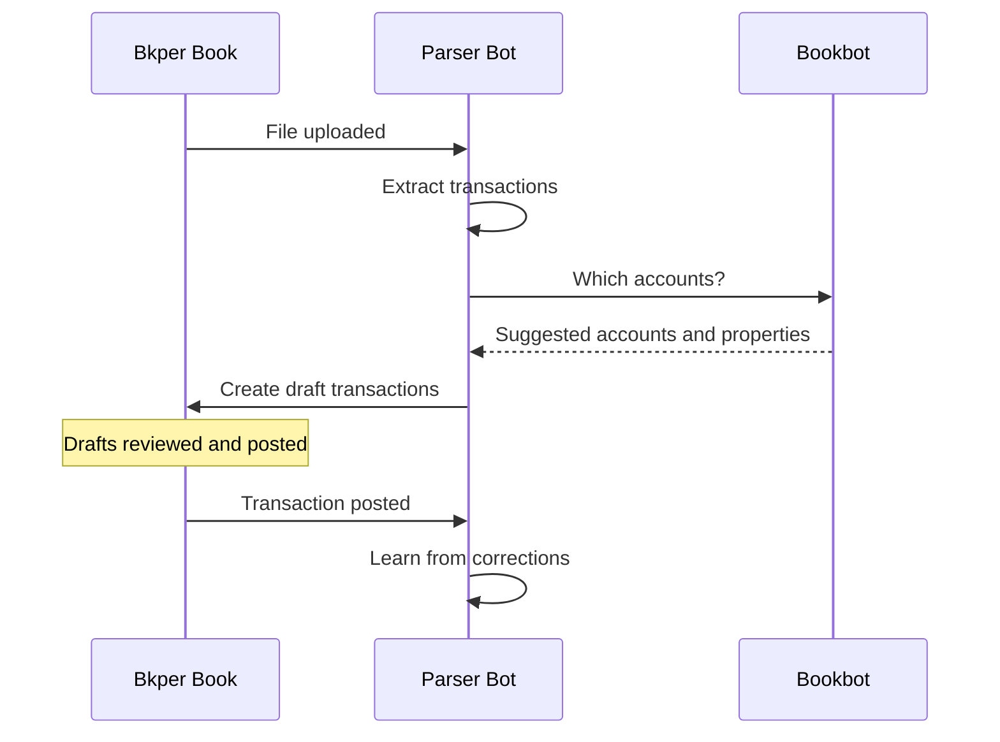

# Parser Bot

Reads your documents and turns them into draft transactions. Drag invoices, receipts, or bank statements into your book — Parser Bot extracts dates, amounts, and descriptions with AI, asks [Bookbot](https://bkper.com/apps/bookbot) for the right accounts, and records unposted drafts for you to review.

Parser Bot learns from your corrections and improves its extraction over time. It never posts transactions: you review and post every draft.

## How it works



**Upload** — select an account and drop a file into the book. Parser Bot extracts transactions from the document and creates drafts. For bank statements and CSVs, it creates one transaction per line item. For invoices and receipts, it creates a single transaction with the file attached.

**Attach** — drop a file onto an existing transaction. Parser Bot fills in the missing amount, date, and description from the file, adds extracted custom properties, and updates the transaction.
> *Note: Attachments are always treated as invoices or receipts, even if the file is a multi-page statement.*

**Type** — when you create a transaction without an attachment, Parser Bot fills a missing amount from the description and replaces an automatically filled date with a date found in the description.

Parser Bot detects the document type automatically:
- **CSV files** are always treated as statements (one transaction per row).
- **PDFs and images** are analyzed to decide if they contain a statement table (multiple transactions) or an invoice/receipt (single transaction).

## Accounts come from Bookbot

Parser Bot reads; [Bookbot](https://bkper.com/apps/bookbot) finds accounts. Before recording drafts, Parser Bot sends them to Bookbot in one request per book. Bookbot suggests the missing From or To account from your posted transaction history and, when every matching transaction shares a custom property (for example, `category` or `project`), copies that property onto the draft. Accounts you selected and properties already on the draft are never replaced.

To tune how accounts are found, use Bookbot's settings, such as `agent_discovery_examples`. When you correct an account Bookbot suggested and post the transaction, Bookbot re-checks other pending drafts.

If Bookbot cannot be reached, Parser Bot still records the drafts with the extracted data and without suggested accounts, and its response in the book activity includes a warning. Nothing is posted.

## AI allowance behavior

Parser Bot's AI inference runs through Bkper AI using the allowance associated with its installation principal. Document extraction and learning use Gemini Flash with medium reasoning, lightweight classification and field utilities use Gemini Flash Lite with minimal reasoning, and semantic comparisons use the decision model. Account suggestions are inferred by Bookbot and attributed to Bookbot. For Business and Professional subscriptions, the Bkper AI allowance may be shared across the domain.

When the allowance is exhausted:

- document extraction fails without creating partial draft transactions;
- Parser Bot does not bypass the limit through another model provider;
- invoice learning is skipped;
- pending statement learning remains flagged for a later run.

The Bkper AI usage dashboard shows the current allowance and usage attributed to Parser Bot.

## Learning from corrections

When you edit an AI-extracted transaction and post it, Parser Bot compares the posted version against its original extraction. If the data changed significantly, it improves its extraction instructions:

1. **Reflect** — analyze what the extraction got wrong
2. **Curate** — generate new instructions and merge with existing ones
3. **Validate** — re-extract the document with the improved instructions and verify results are better without regressions

The improved instructions are saved to purpose-specific properties on the account or group: `agent_parser_transaction` for invoices and receipts, and `agent_parser_transactions` for statements. Future documents processed through that account or group benefit from the accumulated learning.

For invoices, this runs immediately on post. For statements, Parser Bot flags the account or group and processes improvements asynchronously. Deleting a draft extracted from a statement also flags it, because the row should not have been extracted.

When an account or group has **no stored prompt yet**, the first posted transaction through that account can establish a baseline prompt automatically — even if you made no corrections. This gives Parser Bot a starting point for future improvements.

Correcting only an account does not change Parser Bot's instructions: accounts are Bookbot's job, and Bookbot re-checks other pending drafts after such a correction.

Legacy extraction instruction properties (`agent_prompt`, `agent_prompt_transaction`, `agent_prompt_transactions`, and `agent_prompt_file`) are migrated automatically when Parser Bot next uses the account or group. Their values are copied to the corresponding `agent_parser_*` properties and the legacy properties are removed.

## Configuration

<details>
<summary><strong>Account and group properties</strong></summary>

| Property | Description |
|---|---|
| `agent_parser_transaction` | Custom extraction instructions for invoices and receipts that produce a single transaction |
| `agent_parser_transactions` | Custom extraction instructions for statements and CSVs that produce multiple transactions. Parser Bot appends learned statement instructions here automatically |
| `agent_parser_file` | Custom extraction instructions for file-level metadata properties, such as invoice numbers, statement periods, or bank names |
| `agent_excluded_properties` | Comma- or whitespace-separated property keys to exclude from extraction comparison and learning. Bookbot also honors it when copying properties from history. The effective value is resolved from the account, then the first matching account group, then the book; the first non-empty value wins. Matching is case-insensitive and exact. |
| `agent_parser_url_transaction` | URL of an external invoice/receipt extraction service that returns one transaction |
| `agent_parser_url_transactions` | URL of an external statement extraction service. When set, multi-transaction file parsing is delegated to this endpoint instead of using built-in AI |
| `agent_parser_url_file` | URL of an external file metadata extraction service that returns file properties |

**Example — custom statement extraction instructions:**

```yaml
agent_parser_transactions: |-
  Extract transactions from the statement table.
  - Do not include header rows
  - Include the reference number as a property called "ref"
```

**Example — skip properties that vary per transaction:**

`agent_excluded_properties` uses plain delimiter-separated text, not a JSON array:

```yaml
agent_excluded_properties: "trade_date, settlement_date"
```

The property can be set on the selected account, one of its groups, or the book. The lookup order is:

1. the selected account;
2. the first account group with a non-empty value;
3. the book.

The first non-empty value wins; values are not merged. Keys are matched case-insensitively and exactly, so `category` does not block `category_code`.

</details>

<details>
<summary><strong>Book properties</strong></summary>

| Property | Description |
|---|---|
| `agent_parser_url_transaction` | URL of an external invoice/receipt extraction service for this book. Account and group `agent_parser_url_transaction` take priority |
| `agent_parser_url_transactions` | URL of an external statement extraction service for all statement files in this book. Account and group `agent_parser_url_transactions` take priority |
| `agent_parser_url_file` | URL of an external file metadata extraction service for this book. Account and group `agent_parser_url_file` take priority |
| `agent_excluded_properties` | Book-level fallback list of comma- or whitespace-separated property keys to exclude. It is used only when no non-empty account or account-group value is configured. |

</details>

<details>
<summary><strong>Events handled</strong></summary>

| Event | Behavior |
|---|---|
| `FILE_CREATED` | Extracts transactions from the uploaded file, asks Bookbot for accounts, and creates draft transactions. Delegates purpose-specific extraction to external services when parser URL properties are set |
| `TRANSACTION_CREATED` | When a transaction has an attached file, extracts transaction and optional file metadata, asks Bookbot for accounts, then updates it once. Without an attachment, asks Bookbot for accounts and extracts a missing amount or an automatically filled date from the description |
| `TRANSACTION_POSTED` | Compares posted data against the original AI extraction and improves the prompt if corrections were made |
| `TRANSACTION_UPDATED` | Same as `TRANSACTION_POSTED` |
| `TRANSACTION_DELETED` | Flags the source account for prompt improvement when a statement-extracted transaction is deleted, indicating a false positive |
| `BOOK_AUDITED` | Processes one flagged account or group, running the full improvement pipeline for statement extraction |

</details>

<details>
<summary><strong>Supported file types</strong></summary>

| Format | Extensions |
|---|---|
| CSV | `.csv` |
| PDF | `.pdf` |
| Images | `.jpg`, `.jpeg`, `.png`, `.bmp`, `.webp` |

</details>

<details>
<summary><strong>External extraction service</strong></summary>

External parsers are configured per purpose. A parser URL takes precedence over the GenAI prompt for that same purpose:

- `agent_parser_url_transaction` returns `data.transaction` for invoices and receipts.
- `agent_parser_url_transactions` returns `data.transactions` for statements and CSVs.
- `agent_parser_url_file` returns `file.properties` for file-level metadata.

Lookup priority is account property, account's group property (first match), explicit group property, then book property. The service receives a POST request with file content (base64-encoded), book metadata, and account context when available. When the parser URL is configured on a group property, the request also includes that matched group context.

For statement transactions, each returned transaction can optionally include:
- `book_id` — record the transaction in a different book than the upload target
- `account_name` — assign the transaction to a specific account by name

The same endpoint may be configured for multiple parser URL properties; Parser Bot consumes only the response section for the configured purpose.

</details>

<details>
<summary><strong>Transaction metadata</strong></summary>

Parser Bot stores metadata on processed transactions. These are internal properties (suffixed with `_`) used for learning and traceability:

| Property | Description |
|---|---|
| `agent_extracted_` | Original AI extraction data (JSON). Used to detect corrections when the transaction is posted |
| `agent_file_id_` | ID of the source file. Links statement transactions to their document |
| `agent_credit_account_id_`, `agent_debit_account_id_`, `agent_description_part_`, `agent_discovered_properties_` | Bookbot's account and property suggestions, recorded with the draft so Bookbot can re-check drafts after a correction |

After creating drafts, Parser Bot stores a `transactions_summary` file property for multi-transaction extractions and non-zero single-transaction extractions. Each target book/account entry contains the expected non-zero transaction count and the native Bkper transaction IDs returned by transaction creation. A single-transaction extraction has one summary entry. Zero-amount drafts are still created but excluded from the summary, so a file containing only zero-amount transactions does not receive one. If a fetched file already has `transactions_summary`, Parser Bot skips parsing it again. The order of IDs in an entry is not significant.

`transactions_summary` is owned by Parser Bot and cannot be supplied or overridden by an external file-properties parser.

</details>

## Learn more

- [Bookbot](https://bkper.com/apps/bookbot) — finds accounts for your transactions
- [Recording transactions](https://bkper.com/docs/guides/using-bkper/record-guide) — how to record and manage transactions in Bkper
